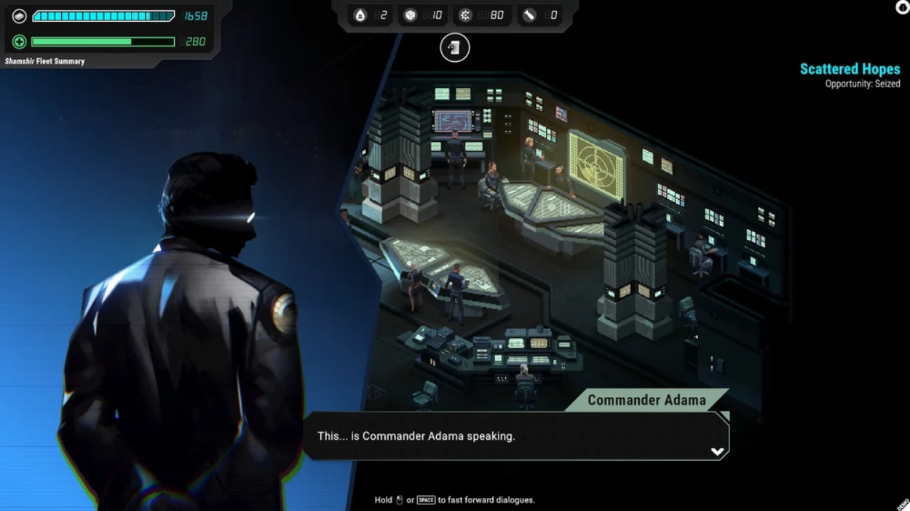

> Take command of a fleet escaping the annihilation of the Twelve Colonies. Manage crises on board as you prepare for the next encounter with the Cylon Fleet. Times are dire, and hard choices must be made. Your only hope: rejoin the Battlestar Galactica.



*Battlestar Galactica: Scattered Hopes* is set to take place during the first two seasons of the show. Humanity has been decimated by the Cylons, and the fleet lead by Commander Adama's Battlestar Galactica is setting route to a hypothetical Earth.

I worked on the game as Lead Narrative Designer, alongside [Actezéro](https://acte-zero.com/)'s Anthony Jauneaud and Rik Godwin, and Tom Jubert (FTL, The Talos Principle).

Our take on this plot is that the Galactica's fleet is not the only one who survived. In a twelve-planet civilization, there must be other scattered fleets who got Adama's message and fought their way to rejoin the main fleet.

The main challenge was to combine the iterative nature of roguelite games and narrative consistency together. The game was pitched as FTL and Reigns mixed together, so its narrative had to adapt to the repetitiveness of the runs.

As I explained in a [Steam news article](https://store.steampowered.com/news/app/2535950/view/540007781835473286?l=english), we needed some key variables to reflect the state of the fleet. That's where the factions came from. They represent how the people in the fleet react to how it is going, and through crises and events we made them interact with every possible system in the game.