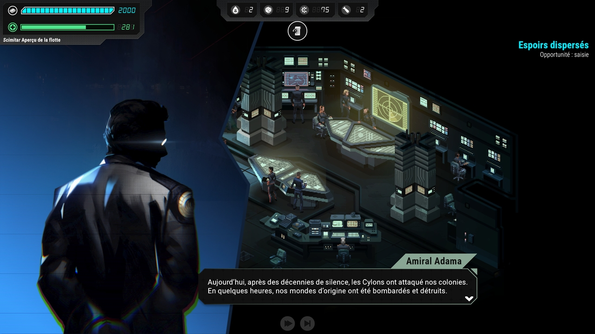

> Prenez le commandement d'une flotte qui échappe à l'annihilation des Douze Colonies. Gérez des crises internes tout en vous préparant à votre prochaine rencontre avec la flotte des Cylons. Les temps sont durs, et il faudra faire des choix. Votre seul espoir: retrouver le Battlestar Galactica.



*Battlestar Galactica: Scattered Hopes* se passe pendant les deux premières saisons de la série. L'humanité a été décimée par les Cylons et la flotte menée par le Battlestar Galactica et le Commandant Adama fait route vers une hypothétique Terre.

J'ai travaillé sur le jeu en tant que Lead Narrative Designer, aux côtés d'Anthony Jauneaud et Rik Godwin d'[Actezéro](https://acte-zero.com/), ainsi que Tom Jubert (FTL, The Talos Principle).

Notre point de départ était que la flotte du Galactica n'était pas la seule à avoir survécu. Dans une civilisation composée de douze planètes, il doit y avoir d'autres flottes éparpillées qui ont reçu le message d'Adama et qui ont lutté pour rejoindre la flotte principale.

Le défi principal était de combiner la nature itérative des roguelites et la cohérence narrative. Le jeu a été présenté initialement comme un mélange entre FTl et Reigns, et donc sa narration devait s'adapter à la répétitivité des runs.

Comme je l'ai développé dans un [article Steam](https://store.steampowered.com/news/app/2535950/view/540007781835473286?l=english), il nous fallait trouver des variables clés pour refléter l'état de la flotte. C'est de là que viennent les factions: elles représentent la façon dont les habitants de la flotte réagissent à ce qui se passe, et par les crises et les événements, nous les avond fait interagir avec tous les systèmes possibles dans le jeu.