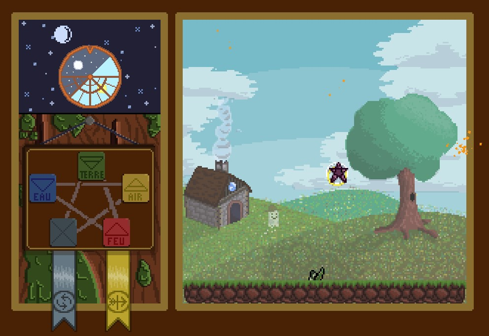

> The world has collapsed. All that is left is a ghost, a bunch of ruins, and plants that try to win them back. As a witch, your task is to give them the right nudge, and let time and nature do the rest.

## An Idle Puzzle Game
*Greenwitch Grove* is a puzzle game that requires the players to help a plant grow to reach a star. However, they don't control the plant itself, but only four elements (water, earth, air, fire) in order to help the plant.

The only input that is required from the player is to chose an element during the day. Then, during the night, the plant grows accordingly.
- Water makes the plant grow up
- Earth makes it grow faster
- Fire cancels the last move
- Air makes the plant go left or right

Every action comes with its sound effect and the music is influenced by the player's actions.

## Pixel Art and Game Design
In this project, I made some pixel art, especially the landscape and the plant assets. I also made game and level design.

The game was made with the game engine [heaps.io](https://heaps.io/), based on [Haxe](https://haxe.org/) as the programmer, Axel De Conti, was experimenting around this engine back then.

[💻 Play on Itch.io](https://martinrgt.itch.io/greenwitch-grove)